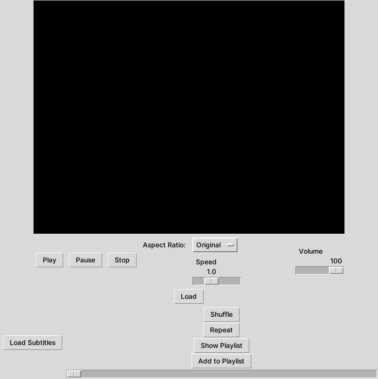

# Cinefy

A desktop video player written in Python with Tkinter and VLC. Built for the Software Development Project lab.



## Features

- Open MP4, AVI and MKV files and play, pause or stop them
- Volume and playback speed (0.5× to 2×) sliders
- A seek bar that follows the video and jumps when you drag it
- Subtitles from `.srt` files
- A playlist: add videos, view the list, remove a video, play the one you pick
- Shuffle and repeat
- Aspect ratio: original, 16:9, 4:3 or 1:1

## How it's built

The code follows a layered design (see `Layered architecture 210213,210218.pdf`):

| File | Layer |
| --- | --- |
| `gui.py` | The window and its widgets |
| `Playlist.py` | Playlist, subtitles, shuffle and repeat |
| `Functions.py` | Player actions (load, play, seek, volume, speed, aspect ratio). Combines the two layers above into `VideoPlayer` |
| `Cinefy.py` | Starts the app |

## Run it

You need Python 3.9 or later with Tkinter, and [VLC media player](https://www.videolan.org/vlc/) installed (python-vlc uses its library). Use the 64-bit VLC with 64-bit Python.

```bash
pip install -r requirements.txt
python Cinefy.py
```

On Linux, install Tkinter and VLC with your package manager, for example `sudo apt install python3-tk vlc`.

## Tests

```bash
pip install -r requirements-dev.txt
python -m pytest
```

There are 20 tests covering loading, play/pause/stop, volume, speed, seeking, subtitles, the playlist (adding, removing, shuffling, repeat) and aspect ratio. VLC is replaced by a stand-in, so it doesn't need to be installed for the tests. Tkinter needs a screen; on a server, run `xvfb-run -a python -m pytest`. GitHub Actions runs the tests on every push.
